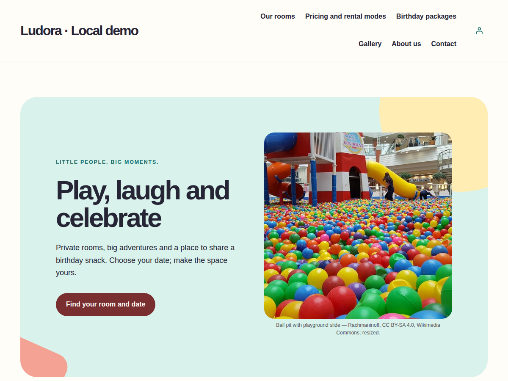

# Ludora

A WordPress block theme and room booking plugin for children's party venues, indoor playgrounds and celebration spaces.



Ludora combines native WordPress site editing with exclusive room reservations. Each installation represents one venue, with one or more independently bookable rooms.

English is the primary language for the project, interface and documentation. Spanish translations and demo content are also available.

## Features

- Block theme with editable templates, three homepage layouts and visual variations.
- Child theme for customizations without modifying the parent.
- Independent booking plugin that keeps business data separate from presentation.
- Hourly rentals, configurable shifts and full business days.
- Opening schedules, closures, date-specific rates, preparation buffers and capacity limits.
- Extras, packages and shared-capacity resources.
- Guest requests, private reservation links, administration, notifications and CSV exports.
- Atomic inventory transactions, expiring checkout holds and server-calculated prices.
- Optional full-payment integration with WooCommerce.
- English-first interface, documentation and editable demo content, with Spanish translations.

Manual booking requests work without WooCommerce. Deposits, split payments and multiple reservations per cart are outside the current scope.

## Requirements

- WordPress 7.1.4 or later.
- PHP 8.4 or later, 64-bit, with at least 256 MB of memory.
- An InnoDB-capable database; the development environment uses MariaDB 11.4.8.
- WooCommerce 11.3.0 for the optional payment integration.
- HTTPS for a live installation.

## Installation

1. Install and activate the parent theme from `ludora.zip` under **Appearance → Themes**.
2. Install `ludora-booking.zip` under **Plugins** to enable booking features. The theme also offers voluntary companion installation through TGM Plugin Activation.
3. Optionally install and activate `ludora-child.zip` for customizations.
4. Configure venue details, rooms, availability, rates and booking conditions under **Ludora**.
5. Add booking blocks to your pages, or import an English or Spanish demo under **Ludora → Demo import**.

For payments, install WooCommerce separately from WordPress.org and configure the store, taxes and chosen payment method. One reservation replaces the entire cart. Test your payment method in its sandbox before enabling live transactions.

The installable ZIPs are generated locally using the packaging commands below. The full source package must be extracted before installing its individual theme and plugin ZIPs. Buyer hosting does not need Node, npm or Composer.

## Local development

Docker Compose provides WordPress, MariaDB and Mailpit:

```sh
cp .env.example .env
sh scripts/setup.sh
```

On a fresh installation, setup prompts for an administrator password. Existing installations retain their credentials.

| Service | URL |
| --- | --- |
| Website | http://localhost:8095 |
| Administration | http://localhost:8095/wp-admin/ |
| Email capture | http://localhost:8029 |

The default administrator username is `ludora-admin`. To reset its password:

```sh
docker compose run --rm cli user update ludora-admin --prompt=user_pass
```

Local services bind to loopback. Keep `.env`, credentials, database volumes and generated reports out of version control.

## Build and test

```sh
npm ci
npm run build
npm run lint:php
sh scripts/test-integration.sh
```

Browser tests use Playwright and the pinned local Node binary:

```sh
node_modules/.bin/node node_modules/@playwright/test/cli.js install chromium

LUDORA_ADMIN_PASSWORD='<local password>' \
  node_modules/.bin/node node_modules/@playwright/test/cli.js test

LUDORA_WC_BROWSER=1 \
  node_modules/.bin/node node_modules/@playwright/test/cli.js test tests/browser/woocommerce.spec.js
```

Run state-changing fixtures sequentially against a local test database. Some browser suites require optional services or fixtures and are skipped when those prerequisites are absent. Reports are generated under `tests/artifacts/` and are not committed.

A separate environment for installing packaged products is available in `compose.clean.yaml`, using ports 8096 and 8030 and independent volumes.

## Packaging

```sh
node_modules/.bin/node scripts/build-docs.mjs
python3 scripts/package.py
python3 scripts/audit-package.py
```

Generated files are written to `dist/`:

| File | Contents |
| --- | --- |
| `ludora.zip` | Parent theme |
| `ludora-child.zip` | Child theme |
| `ludora-booking.zip` | Booking plugin |
| `ludora-full-package.zip` | Installable products, sources, documentation and licenses |
| `checksums.json` | Archive sizes and SHA-256 checksums |

The packaging process excludes credentials, WordPress installations, development dependencies and generated test reports.

## Project structure

```text
themes/ludora/          Block theme
themes/ludora-child/    Child theme
plugins/ludora-booking/ Booking engine, administration and blocks
docs/                  User guides and technical documentation
tests/                 Domain, database and browser tests
scripts/               Build, validation and packaging tools
licenses/              Third-party license texts
```

## Documentation

Start with the English documentation:

- [Installation and user guide](docs/guides/en.html)
- [Booking model and operations](docs/booking-model.md)
- [Assets and third-party licenses](docs/assets-and-licenses.md)

Additional languages:

- [Spanish guide](docs/guides/es.html)

The HTML guides can be opened offline or served as static files. Demo prices, venue details and photographs are examples; replace them with your business's own information and authorized media.

## License

Original project code is licensed under **GPL-2.0-or-later**. See [LICENSE](LICENSE) and [NOTICE.md](NOTICE.md).

Bundled demonstration photographs retain **CC BY-SA 4.0**, with source attribution in the [asset ledger](docs/assets-and-licenses.md). Third-party components retain their original licenses. The source-code license does not grant trademark rights to the product name.
